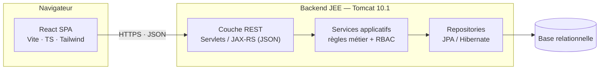

# System Design — Application de gestion du laboratoire LIAS

> Document d'architecture. Public : équipe projet (JEE — Master DS&BD).
> Compagnon : [`data-model.md`](data-model.md).

---

## 1. Objectifs du système

L'application centralise la **mémoire institutionnelle** du laboratoire :

- Centraliser la gestion du LIAS et tracer les activités scientifiques & administratives.
- Capitaliser la mémoire (documents, évènements, décisions).
- Structurer la gestion des membres et des responsabilités.
- Faciliter la production du **rapport annuel obligatoire** (condition de budget).
- Améliorer la collaboration interne et externe.

**Principe directeur :** *aucune donnée n'est jamais supprimée* — tout changement
(statut, rôle, mandat, affiliation) est **historisé** et traçable.

---

## 2. Architecture (vue d'ensemble)

Architecture **3-tiers** classique, découplée en SPA + API REST.



Le backend suit une **architecture en couches (hexagonale)** déjà amorcée
(`com.lias.domain` / `application` / `infrastructure` / `presentation`).

**État actuel :** le frontend fonctionne avec des **données mock**
(`frontend/src/data/`). Le branchement REST est documenté §8 et remplacera le
barrel `@/data` par un client API, sans changer les composants.

---

## 3. Stack technique

| Couche | Choix | Rôle |
|---|---|---|
| UI | React 18 + TypeScript 5 | Composants, typage métier |
| Build | Vite 5 | Dev server + bundle |
| Style | TailwindCSS 3 (tokens CSS) | Design-system |
| Routing | React Router 6 | Navigation + garde RBAC |
| Backend | Java 21, Jakarta Servlets, Tomcat 10.1 | API REST |
| Persistance | JPA / Hibernate (à venir) | ORM |

---

## 4. Typologie des utilisateurs

Le cahier des charges impose une **séparation stricte statut ⇄ rôle**.

- **Statut** (appartenance) : `permanent`, `associe`, `doctorant`, `retraite`, `ancien`.
- **Rôle de gouvernance** (responsabilité, orthogonal) : `directeur`, `vice-directeur`,
  `chef-equipe`, `membre`, `aucun`.
- **Vue / profil d'accès** (pour le RBAC de l'UI) : `directeur`, `permanent`,
  `doctorant`, `admin`, `visiteur`.

> Un même membre peut être *permanent* (statut) **et** *chef d'équipe* puis *directeur*
> (rôles successifs) sans qu'aucune donnée antérieure ne soit perdue.

---

## 5. Carte des modules (cahier des charges → écrans)

| # | Module (CDC) | Écran frontend | État |
|---|---|---|---|
| 3 | Profils membres | `Profils` | ✅ porté |
| 5 | Gouvernance / Mandats | `Mandats` | ✅ porté |
| — | Tableau de bord (synthèse) | `Dashboard` | ✅ porté |
| 6 | Demandes d'adhésion | `Adhesions` | ✅ porté |
| 11 | Rapport d'activité annuel | `Rapport` | ✅ porté |
| 9 | Évènements scientifiques | `Evenements` | ✅ porté |
| 20 | Calendrier | `Calendrier` | ✅ porté |
| 12 | Publications | `Publications` | ✅ porté |
| 10 | Archivage documentaire | `Documents` | ✅ porté |
| 13 | Communication interne | `Communication` | ✅ porté |
| 14–15 | Matériel & besoins | `Materiel` | ✅ porté |
| 16 | Conventions & collaborations | `Conventions` | ✅ porté |
| 17 | Procès-verbaux (PV) | `PV` | ✅ porté |
| 18 | Recherche globale | `Recherche` | ✅ porté |
| 19 | Notifications | `Notifications` | ✅ porté |
| 5.1 | Administration système | `Admin` | ✅ porté |

---

## 6. Matrice RBAC

Source de vérité : `frontend/src/data/access.ts` (`MODULE_ACCESS`).
✓ = autorisé · — = verrouillé (🔒).

| Module | Directeur | Permanent | Doctorant | Admin | Visiteur |
|---|:--:|:--:|:--:|:--:|:--:|
| Tableau de bord | ✓ | ✓ | ✓ | ✓ | — |
| Profils | ✓ | ✓ | ✓ | ✓ | ✓ |
| Mandats | ✓ | ✓ | ✓ | ✓ | ✓ |
| Demandes d'adhésion | ✓ | — | — | — | — |
| Rapport annuel | ✓ | ✓ | — | — | — |
| Évènements | ✓ | ✓ | ✓ | ✓ | ✓ |
| Calendrier | ✓ | ✓ | ✓ | ✓ | ✓ |
| Publications | ✓ | ✓ | ✓ | ✓ | ✓ |
| Archive documentaire | ✓ | ✓ | ✓ | ✓ | — |
| Communication | ✓ | ✓ | ✓ | — | — |
| Matériel | ✓ | ✓ | — | ✓ | — |
| Conventions | ✓ | ✓ | — | ✓ | ✓ |
| Procès-verbaux | ✓ | ✓ | — | ✓ | — |
| Recherche globale | ✓ | ✓ | ✓ | ✓ | ✓ |
| Notifications | ✓ | ✓ | ✓ | ✓ | — |
| Administration | ✓ | — | — | ✓ | — |

**Application côté frontend :** garde `RequireAccess` (`src/App.tsx`) + verrouillage
visuel des entrées de menu (`Sidebar` / `NavItem`). Côté backend, le même
`MODULE_ACCESS` devra être **revérifié sur chaque endpoint** (ne jamais faire
confiance au client).

---

## 7. Règles transverses

1. **Aucune perte de données** — suppression logique uniquement (comptes *gelés* /
   *désactivés*), historique conservé.
2. **Tout est historisé** — rôles, statuts, mandats, affiliations → tables temporelles
   `(from, to)`.
3. **Séparation statut / rôle** (cf. §4).
4. **Traçabilité** — toute action importante (validation d'adhésion, ajout de document,
   décision de mandat) est journalisée.
5. **Autorité du mandat actif** — seul le directeur du **mandat en cours** valide les
   adhésions et les demandes de matériel.

---

## 8. Surface REST proposée (pour le branchement backend)

Conventions : préfixe `/api`, JSON, verbes HTTP standards, pagination `?page&size`.

| Domaine | Endpoints |
|---|---|
| Membres | `GET /api/members`, `GET /api/members/{id}`, `PUT /api/members/{id}`, `GET /api/members/{id}/history` |
| Équipes | `GET /api/teams` |
| Mandats | `GET /api/mandats`, `GET /api/mandats/current` |
| Adhésions | `GET /api/adhesions`, `POST /api/adhesions`, `POST /api/adhesions/{id}/decision` |
| Évènements | `GET /api/events`, `POST /api/events`, `GET /api/events/{id}/documents` |
| Documents | `GET /api/documents`, `POST /api/documents` (upload), `GET /api/documents/{id}/download` |
| Publications | `GET /api/publications?author&year&team`, `POST /api/publications` |
| Conventions | `GET /api/partners`, `GET /api/conventions` |
| PV | `GET /api/meetings`, `POST /api/meetings`, `POST /api/meetings/{id}/pv` |
| Matériel | `GET /api/materials`, `GET /api/material-requests`, `POST /api/material-requests` |
| Rapport | `GET /api/reports/{year}` (génération agrégée) |
| Recherche | `GET /api/search?q=` (transverse) |
| Notifications | `GET /api/notifications` |
| Auth | `POST /api/auth/login`, `POST /api/auth/logout`, `GET /api/auth/me` |

Le frontend remplacera les imports `@/data` par un **client API** (`src/lib/api.ts`)
renvoyant les mêmes types (`src/types/`), gardant les écrans inchangés.

---

## 9. Architecture frontend

```
frontend/src/
├── types/        # vocabulaire métier (source de vérité TS)
├── data/         # données mock (→ remplacé par client API)
├── lib/          # helpers (format dates, cn)
├── config/       # navigation (sections + RBAC keys)
├── context/      # SessionContext (vue courante = RBAC)
├── components/
│   ├── ui/       # design-system (Button, Card, Badge, KPI, Avatar…)
│   └── layout/   # AppShell, Header, Sidebar, RoleToggle
└── routes/       # un fichier par écran
```

**Flux RBAC :** `SessionContext` expose la vue courante → `Sidebar` verrouille les
entrées interdites → `RequireAccess` redirige toute route interdite vers `/profils`
(accessible à toutes les vues).
